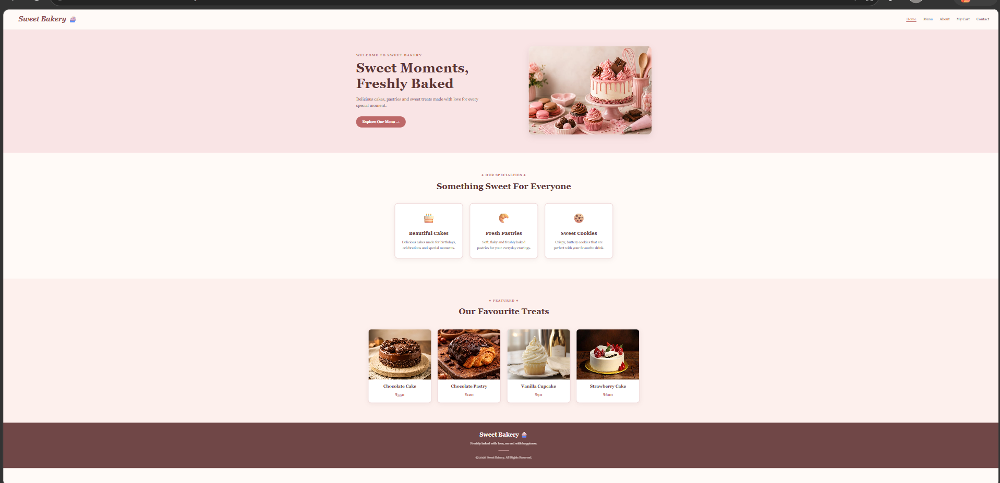
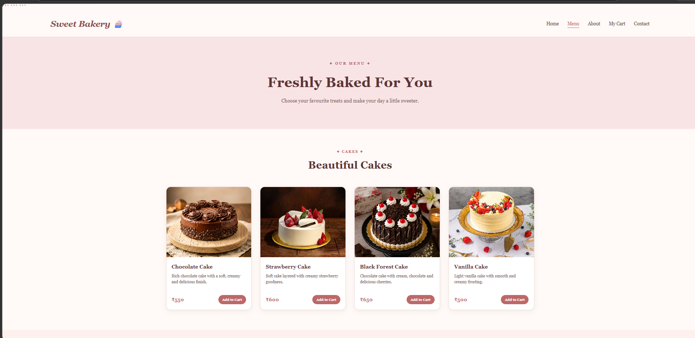
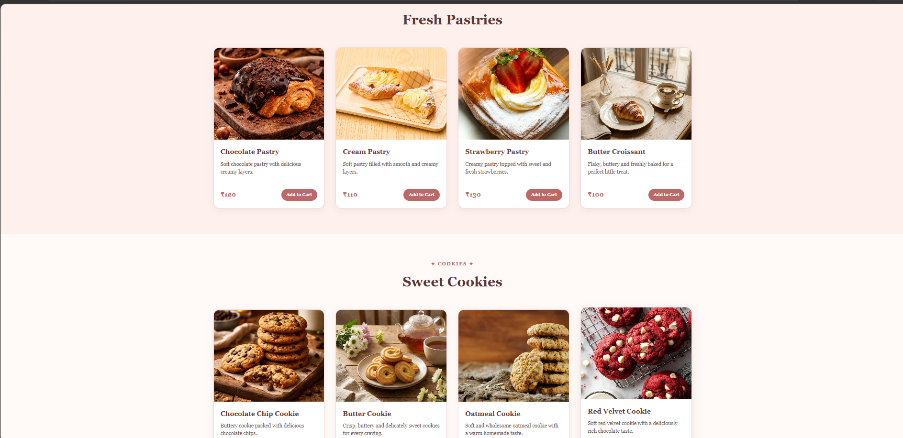
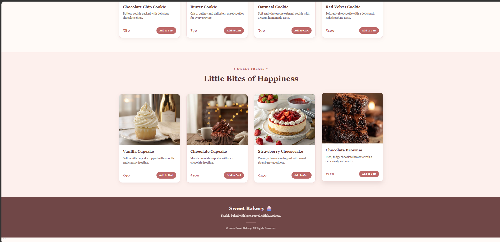
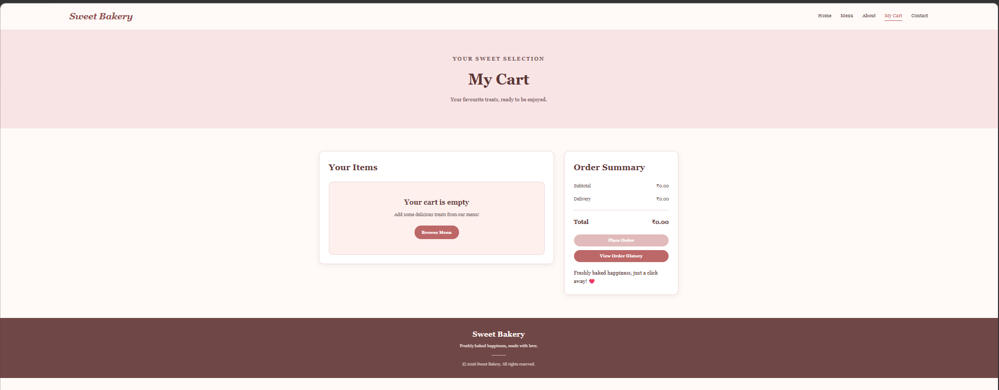
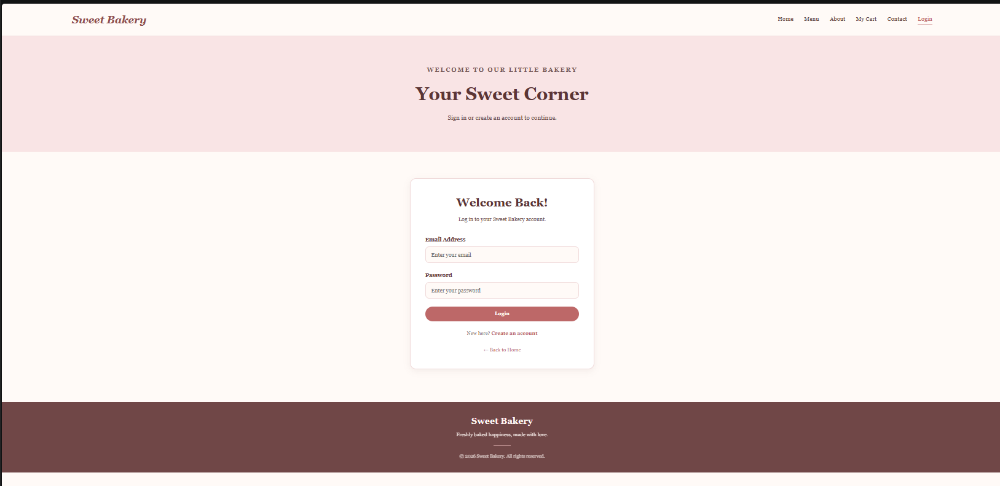
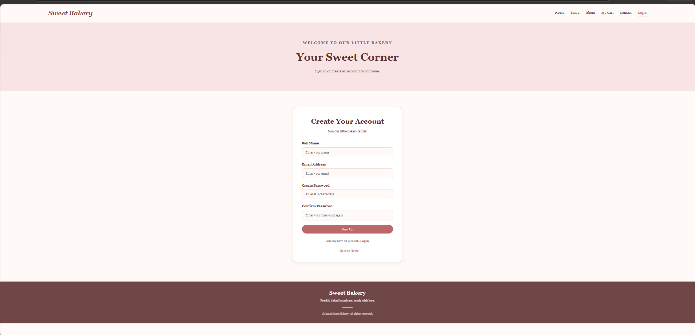
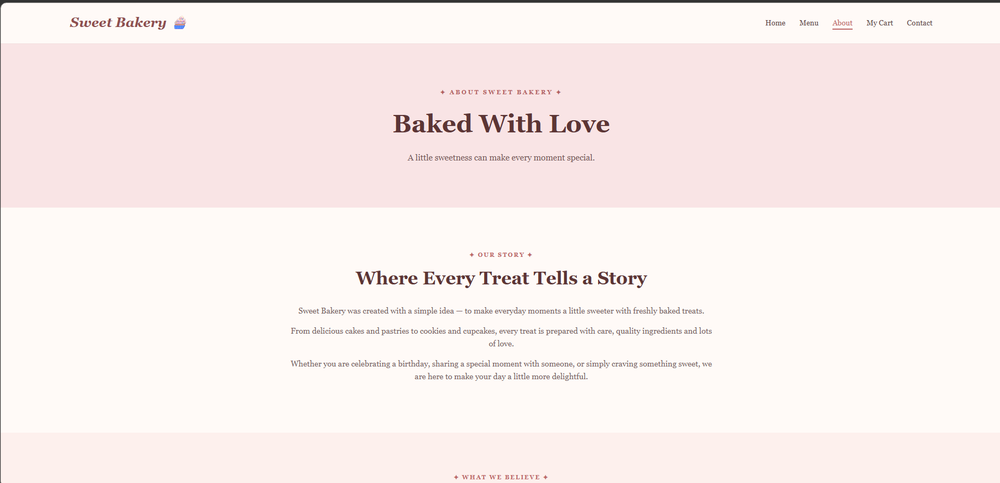
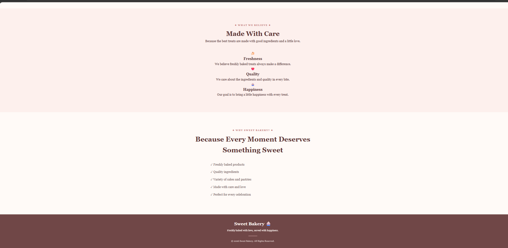
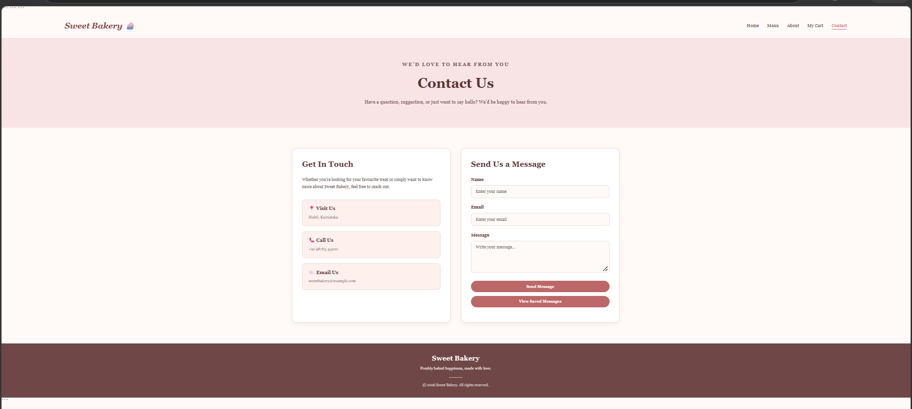

# 🧁 Sweet Bakery

A sweet and welcoming bakery website built using HTML, CSS and JavaScript. Explore delicious cakes, pastries and cookies, browse the menu, and manage your shopping cart.

## ✨ Features# 🧁 Sweet Bakery — Full Stack Web Application

A bakery-themed full-stack web application built using **Python, Flask, SQLite, HTML, CSS, and JavaScript**.

Sweet Bakery allows users to create accounts, explore bakery products, manage their shopping carts, place orders, view order history, and send contact messages.

---

## ✨ Features

### 🔐 User Authentication
- User registration and login.
- Secure password hashing.
- Flask session-based authentication.
- Protected application pages.

### 🍰 Product Menu
- 16 bakery products across four categories.
- Product information and prices stored in SQLite.
- Add products to the shopping cart.

### 🛒 Shopping Cart
- Add products to the cart.
- Increase product quantities.
- Remove products.
- Automatically calculate subtotal and total.
- Cart data is stored separately for each user.

### 📦 Order Management
- Place orders using cart contents.
- Store order details in SQLite.
- Preserve product prices in order records.
- View personal order history.

### 💌 Contact Messages
- Submit contact messages through the website.
- Store messages in SQLite.
- View messages associated with the logged-in account.

---

## 🛠️ Technology Stack

| Technology | Purpose |
|---|---|
| HTML | Page structure |
| CSS | Website styling |
| JavaScript | Frontend interactions |
| Python | Backend programming |
| Flask | Web framework and APIs |
| SQLite | Database |
| Werkzeug | Password hashing |

---

## 📸 Screenshots

### Homepage


### Menu






### Shopping Cart


### Login


### Create Account


### About




### Contact


---

## 📂 Project Structure

```text
Sweet-Bakery-Full-Stack/
│
├── app.py
├── config.py
├── database.py
├── schema.sql
├── requirements.txt
├── README.md
├── .gitignore
│
├── instance/
│   └── sweet_bakery.db
│
├── output_images/
│
├── static/
│   ├── css/
│   │   └── style.css
│   │
│   ├── js/
│   │   ├── auth.js
│   │   └── script.js
│   │
│   └── images/
│       ├── banners/
│       ├── cakes/
│       ├── cookies/
│       ├── desserts/
│       └── pastries/
│
└── templates/
    ├── about.html
    ├── contact.html
    ├── index.html
    ├── login.html
    ├── menu.html
    ├── my-cart.html
    └── reset-login.html
```

---

## 🚀 Installation and Setup

### 1. Clone the repository

```powershell
git clone https://github.com/Anju-AI-2026/Sweet-Bakery-Full-Stack.git
```

### 2. Open the project folder

```powershell
cd Sweet-Bakery-Full-Stack
```

### 3. Create a virtual environment

```powershell
python -m venv .venv
```

### 4. Activate the virtual environment

```powershell
.\.venv\Scripts\Activate.ps1
```

### 5. Install dependencies

```powershell
pip install -r requirements.txt
```

### 6. Run the application

```powershell
python app.py
```

Open the application in your browser:

```text
http://127.0.0.1:5000
```

The SQLite database and initial product records are initialized automatically when the application starts.

---

## 🗄️ Database Design

The application uses SQLite with the following main tables:

- `users` — registered user accounts.
- `products` — bakery product information.
- `cart_items` — user-specific shopping cart items.
- `orders` — placed orders.
- `order_items` — individual products belonging to orders.
- `contact_messages` — user contact messages.

---

## 🎯 Learning Outcomes

This project demonstrates practical implementation of:

- Flask application development.
- Frontend and backend integration.
- REST-style API endpoints.
- HTTP requests using JavaScript Fetch API.
- SQLite database operations.
- SQL table relationships and foreign keys.
- User authentication and session management.
- Password hashing.
- CRUD operations.
- Database-backed shopping cart and order management.
- Git and GitHub version control.

---

## 👩‍💻 Developer

**Anjali Ramesh Sangannavar**

Computer Science and Engineering Diploma Student

GitHub: [Anju-AI-2026](https://github.com/Anju-AI-2026)

---

Copyright © 2026 Anjali Ramesh Sangannavar. All rights reserved.

- Beautiful bakery homepage
- Product menu with multiple categories
- About and Contact pages
- Login and Sign Up functionality
- Shopping cart
- Responsive webpage design

## 🛠️ Technologies Used

- HTML5
- CSS3
- JavaScript
- Local Storage
- Session Storage

## 📸 Output Screenshots

### 🏠 Homepage


### 🍰 Menu


### 💗 About Us


### 📩 Contact Us


### 🛒 My Cart


## 🚀 How to Run

1. Clone or download this repository.
2. Open the `04-sweet-bakery` folder.
3. Open `index.html` using VS Code Live Server.
4. Create an account or log in to explore the website.

## 👩‍💻 Developer

**Anjali Ramesh Sangannavar**
